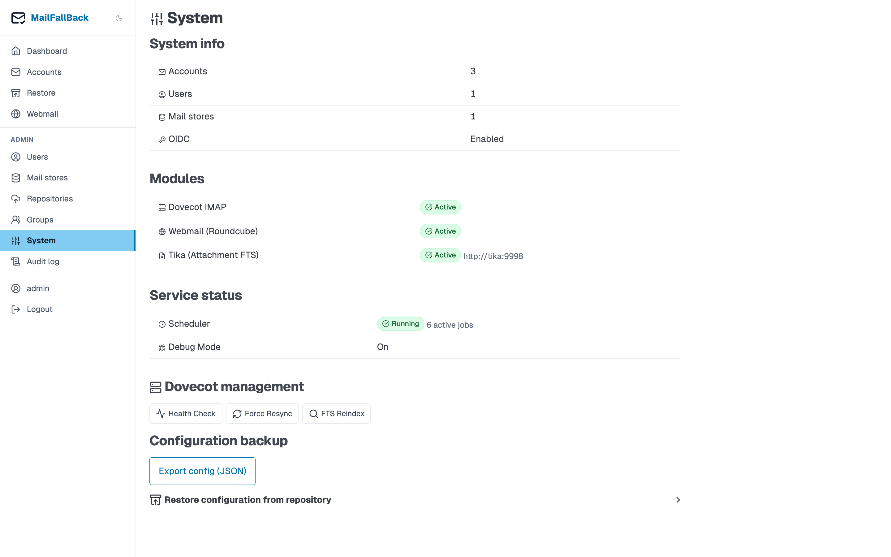

# System Settings

The System page provides system-wide configuration and operational controls.



## Modules

The modules section shows which optional components are active:

| Module | Status | Description |
|--------|--------|-------------|
| **Webmail** | Enabled/Disabled | Roundcube integration |
| **FTS** | Enabled/Disabled | Full-text search (always on when Dovecot is available) |
| **Tika** | Enabled/Disabled | Attachment content indexing |

Module status is determined by environment variables and service availability.

## Service Status

Real-time health check of connected services:

- **Dovecot** - checks the doveadm HTTP API endpoint
- **Tika** - checks the Tika REST API endpoint
- **Database** - PostgreSQL connection status
- **Scheduler** - whether APScheduler is running and processing cron jobs

## FTS Reindex

Trigger a full-text search reindex across all accounts. This is useful after:

- Enabling or disabling Tika
- Recovering from corrupted FTS indexes
- Upgrading Dovecot

The reindex runs as a background task. Progress is shown on the System page.

!!! note "Automatic reindex"
    MFB automatically triggers a reindex when it detects that the FTS configuration has changed (e.g. Tika was toggled). You normally do not need to trigger this manually.

## Force Resync

Force an immediate sync of all accounts, ignoring schedules. This queues a sync job for every enabled account. Useful after a bulk import or when you want to ensure all accounts are up to date.

## Health Check

The System page shows the results of the application health check endpoints:

- `/healthz` - basic liveness check
- `/readyz` - readiness check including database connectivity

These are the same endpoints used by Docker health checks and Kubernetes probes.

## Background Tasks

Active background tasks are displayed with progress:

- **FTS Reindex** - progress bar showing accounts processed
- **Store Migration** - per-account progress with file counts

Tasks can be monitored but not cancelled from this page (migrations can be cancelled from the account detail page).

## Config Export / Import

Export the current MFB configuration (accounts, users, groups, stores) as a JSON file, or import from a previously exported file. This is useful for:

- Backing up MFB's own configuration
- Migrating between MFB instances
- Disaster recovery

!!! warning "Credentials"
    Exported configs include encrypted credentials. They can only be imported into an instance with the same `MAILFALLBACK_SECRET_KEY`. If the secret key differs, imported accounts will need their credentials re-entered.

!!! note "Access tokens are not exported"
    Per-user access tokens (`AppCredential`) are deliberately excluded from the
    export, consistent with notification channels — re-create them on the new
    instance if needed. Separately, rotating `MAILFALLBACK_SECRET_KEY` invalidates
    every existing access token, since each token's `secret_hash` is a keyed-HMAC
    keyed to that secret.

## Prometheus Metrics

MFB exposes metrics at `/metrics` for Prometheus scraping:

- `mailfallback_accounts_total` — total account count
- `mailfallback_jobs_pending` — pending sync jobs
- `mailfallback_sync_total{account,status}` — gauge of retained sync history, **not** a cumulative counter; do not use `rate()` or `increase()` on it
- `mailfallback_sync_last_success_timestamp{account}` — last recorded sync success
- `mailfallback_sync_duration_seconds{account}` — latest completed sync duration
- `mailfallback_maildir_size_bytes{account}` — mailbox disk usage
- `mailfallback_info{version}` — build version

Sync labels use account display names, which need not be unique. The backup metrics below use UUIDs instead.

Set `MAILFALLBACK_METRICS_API_KEY` to enable access. Without a configured key, the endpoint returns 401. Prometheus sends the key as a Bearer token in the Authorization header:

```yaml
# prometheus.yml
scrape_configs:
  - job_name: mailfallback
    bearer_token: your-metrics-api-key
    static_configs:
      - targets: ['mailfallback:8000']
```

### Backup gauges

Mailbox-policy gauges use `policy_id` and `account_id` labels:

| Metric | Meaning |
| --- | --- |
| `mailfallback_backup_last_success_timestamp` | Unix seconds of last recorded successful backup; `0` means no known success |
| `mailfallback_backup_last_run_timestamp` | Unix seconds of last recorded run start; `0` means no known start |
| `mailfallback_backup_last_status{status}` | One-hot `idle`, `running`, `completed`, `failed` status |
| `mailfallback_backup_snapshot_count` | Cached snapshot count; refresh can fail independently of backup success |
| `mailfallback_backup_last_duration_seconds` | Duration of latest successfully completed job; omitted if no timed completed job exists |
| `mailfallback_backup_policy_enabled` | `1` enabled, `0` disabled |

These describe **lifetime policy history**, not the contents or health of the current destination. Repointing a policy preserves history; old snapshots and success timestamps may belong to its previous repository. There is deliberately no destination label on these gauges. Use repository inspection to verify a new destination's contents.

Configuration-backup gauges use `repository_id`:

- `mailfallback_config_backup_last_success_timestamp` — last successful completion in Unix seconds, preserved through later failures; `0` means unknown.
- `mailfallback_config_backup_last_status{status}` — one-hot `ok`, `failed`, `unknown`.
- `mailfallback_config_backup_enabled` — `1` enabled, `0` disabled.

Disabled entities retain their series; accounts without a policy emit no policy series. Migration 030 seeds configuration last success only when the previous recorded status is `ok`. A zero timestamp does not prove a backup never succeeded before an upgrade. Scrapes only read the database; they do not contact restic or storage. Labels exclude names, secrets, URLs and error text. Access to `/metrics` remains instance-wide and requires the dedicated metrics key, not a user's access token.

For optional Helm resources, standalone configuration and receiver setup, see [Monitoring and alerts](monitoring.md).

### Example alerts

These examples assume daily schedules. Adjust age thresholds and `for` periods to your schedules and first-run grace. `for` tracks how long Prometheus observes the condition; it is not an application-side timer. Restrict selectors to the relevant scrape job, and include `job` and `instance` in joins to keep different MFB instances separate.

```yaml
groups:
  - name: mailfallback-backups
    rules:
      - alert: MailFallbackBackupStale
        expr: |
          (time() - mailfallback_backup_last_success_timestamp{job="mailfallback"} > 26 * 3600)
          and on (job, instance, policy_id, account_id)
          (mailfallback_backup_policy_enabled{job="mailfallback"} == 1)
        for: 1h
      - alert: MailFallbackBackupNotStarting
        expr: |
          (time() - mailfallback_backup_last_run_timestamp{job="mailfallback"} > 26 * 3600)
          and on (job, instance, policy_id, account_id)
          (mailfallback_backup_policy_enabled{job="mailfallback"} == 1)
        for: 26h
      - alert: MailFallbackBackupFailed
        expr: |
          (mailfallback_backup_last_status{job="mailfallback",status="failed"} == 1)
          and on (job, instance, policy_id, account_id)
          (mailfallback_backup_policy_enabled{job="mailfallback"} == 1)
        for: 5m
      - alert: MailFallbackConfigBackupStale
        expr: |
          (time() - mailfallback_config_backup_last_success_timestamp{job="mailfallback"} > 26 * 3600)
          and on (job, instance, repository_id)
          (mailfallback_config_backup_enabled{job="mailfallback"} == 1)
        for: 26h
      - alert: MailFallbackConfigBackupFailed
        expr: |
          (mailfallback_config_backup_last_status{job="mailfallback",status="failed"} == 1)
          and on (job, instance, repository_id)
          (mailfallback_config_backup_enabled{job="mailfallback"} == 1)
        for: 5m
      - alert: MailFallbackScrapeUnavailable
        expr: up{job="mailfallback"} == 0
        for: 5m
```

A zero success timestamp also satisfies the stale expression: the `for` period supplies the initial grace. The example policy stale alert therefore warns after one hour without a known success; choose a longer grace for newly configured daily policies if needed. `BackupNotStarting` indicates no recent start, not proof of scheduler failure. A deleted scrape target needs separate monitoring of target discovery because it can disappear from `up` entirely.
